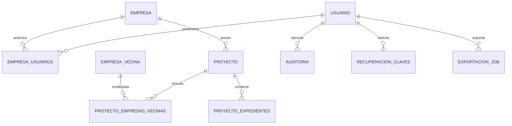

# Modelo de datos — SGPM integral

**Fecha:** 2026-10-11. **Constitución:** 4.2.0-SGPM.
Contrato de diseño, sin migraciones ejecutadas. El bloque canónico conserva todos los
campos de la especificación; las decisiones físicas y campos técnicos posteriores lo
concretan sin reemplazar requisitos funcionales.

## Convenciones físicas

- Esquema interno sgpm, tablas/columnas en snake_case minúsculo sin comillas.
  Proyecto → sgpm.proyecto, Empresa Vecina → sgpm.empresa_vecina, Auditoría → sgpm.auditoria.
- PK SERIAL con INTEGER, FK del mismo tipo. No usar IDENTITY, generado en SQL posterior.
- UTF-8 integral. TIMESTAMP se almacena en UTC; fechas oficiales DATE se conservan sin
  conversión horaria. Interfaz muestra America/Bogota. JSON de auditoría se concreta a JSONB.
- estado de usuario/empresa/proyecto: VARCHAR(20), CHECK ACTIVO/INACTIVO, default ACTIVO.
- Correo normalizado trim/lowercase y UNIQUE en usuario. NIT trim y representación
  consistente validada antes de persistir; no se cambia código catastral arbitrariamente.
- Todo campo no marcado nullable es NOT NULL. Restricciones de tamaño coinciden con spec.
- FKs por defecto RESTRICT; ningún borrado maestro propaga a auditoría ni otras empresas.
- Campo técnico version INTEGER NOT NULL DEFAULT1 en entidades editables; PUT/DELETE
  exige versión vigente, incrementa en cada cambio y retorna409 si hay edición concurrente.
- Estado INACTIVO impide nuevas operaciones de escritura ordinaria sobre su empresa/proyecto;
  Administrador puede reactivar. Historial permanece consultable por usuarios autorizados.

## Contrato canónico de entidades

### Key Entities *(include if feature involves data)*

El esquema siguiente conserva los nombres, tipos, nulabilidad y reglas suministrados.
Es un contrato de datos solicitado por el usuario, no una migración ejecutable.
Las decisiones de consistencia resueltas se registran antes de traducir el contrato al diseño físico.

#### usuario

Cuenta de acceso seguro y trazable.

| Campo | Tipo | Nulo | Regla |
| --- | --- | --- | --- |
| id | SERIAL PK | No | Identificador único. |
| correo | VARCHAR(255) | No | Único; login. |
| password_hash | VARCHAR(255) | No | password_hash(..., PASSWORD_BCRYPT), costo ≥ 10. |
| numero_documento | VARCHAR(50) | No | Documento de identidad. |
| nombre | VARCHAR(255) | No | Nombres y apellidos. |
| ultimo_acceso | TIMESTAMP | Sí | Último inicio exitoso. |
| estado | VARCHAR(20) / BOOL | No | ACTIVO / INACTIVO. |

Roles formales: Administrador, Gerente, Geólogo, Inversionista. Relación N:M con empresas
mediante `empresa_usuarios`, con rol asignado por empresa. Su contrato físico se define
en planificación conforme a la matriz de permisos aprobada anterior.

#### empresa

Persona jurídica titular de proyectos.

| Campo | Tipo | Nulo | Regla |
| --- | --- | --- | --- |
| id | SERIAL PK | No | Identificador único. |
| nit | VARCHAR(50) | No | Único. |
| razon_social | VARCHAR(255) | No | Nombre legal. |
| correo | VARCHAR(255) | No | Correo corporativo principal. |
| telefono | VARCHAR(50) | Sí | Contacto. |
| direccion | VARCHAR(255) | Sí | Dirección fiscal/comercial. |
| ciudad | VARCHAR(100) | No | Municipio o ciudad. |
| departamento | VARCHAR(100) | No | Departamento. |
| logo_url | VARCHAR(255) | Sí | Ruta o URL del logotipo. |
| estado | VARCHAR(20) / BOOL | No | ACTIVO / INACTIVO. |

#### Proyecto

Unidad territorial y administrativa; pertenece a una única empresa (RN-01).

| Campo | Tipo | Nulo | Regla |
| --- | --- | --- | --- |
| id | SERIAL PK | No | Identificador único. |
| empresa_id | INTEGER FK | No | empresa(id). |
| nombre | VARCHAR(255) | No | Nombre del proyecto. |
| descripcion | TEXT | Sí | Alcance técnico. |
| estado | VARCHAR(20) | No | ACTIVO / INACTIVO. |
| mineral_principal | VARCHAR(100) | No | Mineral objetivo. |
| fecha_inicio | DATE | Sí | Inicio de labores o constitución. |
| fecha_fin | DATE | Sí | Fin estimado o real. |
| centroide | GEOMETRY(Point, 4326) | Sí | Centroide geodésico calculado en PostGIS, permitido por constitución 4.2.0-SGPM; índice GiST obligatorio. |
| observaciones | TEXT | Sí | Notas técnicas. |
| creado_por | INTEGER FK | Sí | usuario(id), creador. |
| modificado_por | INTEGER FK | Sí | usuario(id), último modificador. |

#### Empresa Vecina

Identidad competidora compartida y reutilizable entre proyectos (RN-03, RN-04, RN-05).
**Decisión aprobada por el usuario (2026-10-11):** identidad compartida con vínculo por
proyecto y color por vínculo. Esta decisión reemplaza la vinculación directa del esquema
inicial. El color y el orden pertenecen al proyecto, nunca a la identidad global.

| Campo | Tipo | Nulo | Regla |
| --- | --- | --- | --- |
| id | SERIAL PK | No | Identificador compartido de vecina. |
| nombre | VARCHAR(255) | No | Nombre comercial. |
| nit | VARCHAR(50) | Sí | NIT conocido. |
| observaciones | TEXT | Sí | Notas comerciales/jurídicas de la identidad. |

#### proyecto_empresas_vecinas

Entidad de enlace N:M aprobada. Su nombre físico se propone para planificación.

| Campo | Tipo | Nulo | Regla |
| --- | --- | --- | --- |
| id | SERIAL PK | No | Identificador del vínculo. |
| proyecto_id | INTEGER FK | No | Proyecto(id). |
| empresa_vecina_id | INTEGER FK | No | Identidad compartida de Empresa Vecina. |
| color_hex | VARCHAR(10) | No | Violeta automático único por proyecto. |
| orden_registro | INTEGER | No | Orden estable de registro dentro del proyecto. |

Una identidad solo puede tener un vínculo por proyecto. Los patrones diagonales SVG
se determinan por vínculo al superar ocho vecinas. Todos sus expedientes dentro del
proyecto heredan color y patrón; vínculos en otros proyectos conservan su propia simbología.
Ejemplos de tonos: `#8a2be2`, `#9370db`, `#ba55d3`. Los patrones complementan, sin eliminar,
la obligación constitucional de color único dentro del proyecto.
La desvinculación afecta solo al proyecto; la edición de la identidad compartida afecta
sus referencias y debe distinguirse explícitamente de la edición del vínculo.

#### proyecto_expedientes

Vinculación de expedientes propios o vecinos con exclusividad RN-12.

| Campo | Tipo | Nulo | Regla |
| --- | --- | --- | --- |
| id | SERIAL PK | No | Identificador de vínculo. |
| proyecto_id | INTEGER FK | No | Proyecto. |
| codigo_expediente | VARCHAR(100) | No | Código oficial. |
| tipo_expediente | VARCHAR(20) | No | TITULO o SOLICITUD. |
| filiacion | VARCHAR(20) | No | PROPIO o VECINO. |
| empresa_vecina_id | INTEGER FK | Sí | Empresa Vecina(id) compartida; obligatorio si VECINO y con vínculo al mismo proyecto. |
| fecha_asociacion | TIMESTAMP | No | Fecha de registro. |

Restricción inmutable: `CONSTRAINT uq_proyecto_expediente UNIQUE (proyecto_id, codigo_expediente)`. Un duplicado es una violación de unicidad, no una violación de clave foránea; se traduce a HTTP 409 y mensaje amigable sin exponer la excepción del motor.
El código debe existir en la fuente correspondiente al tipo (RN-06). VECINO requiere una
vecina del mismo proyecto; PROPIO exige ausencia de atribución vecina. Los títulos y
solicitudes de un mismo código tampoco pueden duplicarse dentro del proyecto (RN-12).

#### Auditoría

Registro forense inmutable (RF-08.1, RF-08.2).

| Campo | Tipo | Nulo | Regla |
| --- | --- | --- | --- |
| id | SERIAL PK | No | Identificador de evento. |
| usuario_id | INTEGER FK | Sí | usuario(id), ejecutor. |
| accion | VARCHAR(50) | No | INSERT, UPDATE, DELETE, LOGIN, LOGOUT. |
| entidad | VARCHAR(100) | No | Entidad afectada. |
| valores_anteriores | JSON / JSONB | Sí | Snapshot anterior, sin secretos. |
| valores_nuevos | JSON / JSONB | Sí | Snapshot posterior, sin secretos. |
| ip | VARCHAR(45) | No | IPv4/IPv6 de origen. |
| fecha | TIMESTAMP | No | Marca temporal exacta, DEFAULT NOW(). |

Los valores ausentes en INSERT/DELETE se representan coherentemente; no se inventa un
usuario cuando no existe identidad autenticada.

#### Fuentes catastrales externas

`geo_titulos_mineros` y `geo_solicitudes_mineras` residen en la misma base PostgreSQL
9.5.24; un proceso independiente las sincroniza externamente. La aplicación tiene acceso
de solo lectura. Ambas comparten exactamente estos 30 campos estandarizados:

| N.º | Campo | Tipo y regla |
| --- | --- | --- |
| 1 | CODIGO_EXPEDIENTE | VARCHAR(100) UNIQUE NOT NULL |
| 2 | MODALIDAD | VARCHAR(255) |
| 3 | TITULO_ESTADO | VARCHAR(100) |
| 4 | AREA_HA | NUMERIC(14, 4) |
| 5 | CLASIFICACION_MINERIA | VARCHAR(100) |
| 6 | ETAPA | VARCHAR(100) |
| 7 | SOLICITANTES_O_TITULARES | TEXT |
| 8 | MINERALES | TEXT |
| 9 | FECHA_DE_SOLICITUD | DATE |
| 10 | FECHA_DE_EXPEDICION | DATE |
| 11 | FECHA_DE_ANIVERSARIO | DATE |
| 12 | FECHA_DE_EXPIRACION | DATE |
| 13 | PUBLICADO_EN_RUCOM | VARCHAR(50) |
| 14 | PAR | VARCHAR(100) |
| 15 | TITLE_TYPE_CODE | VARCHAR(50) |
| 16 | TENURE_STATUS_CODE | VARCHAR(50) |
| 17 | MINING_CLASSIFICATION_CODE | VARCHAR(50) |
| 18 | TENURE_STAGE_CODE | VARCHAR(50) |
| 19 | CENTROID_COORDINATE | VARCHAR(100) |
| 20 | TENURE_ID | VARCHAR(100) |
| 21 | OBJECTID | INTEGER |
| 22 | MUNICIPIOS | VARCHAR(255) |
| 23 | DEPARTAMENTOS | VARCHAR(255) |
| 24 | MINERALES_INACTIVOS | TEXT |
| 25 | TIPO_TERMINACION | VARCHAR(100) |
| 26 | TERMINATION_TYPE_CODE | VARCHAR(50) |
| 27 | ACTIVE_TENURE_STATUS_IND | VARCHAR(10) |
| 28 | ACTIVE_APPLICATION_STATUS_IND | VARCHAR(10) |
| 29 | FECHA_PROCESO | DATE |
| 30 | the_geom | GEOMETRY(MultiPolygon, 4326) NOT NULL, índice espacial GiST |

CODIGO_EXPEDIENTE y the_geom son NOT NULL; los otros 28 campos admiten NULL conforme al contrato SQL aclarado. Las cinco fechas catastrales son DATE.

## Concreción y extensiones del diseño

### usuario y pertenencia empresarial

Además de los campos canónicos, usuario tiene es_administrador BOOLEAN NOT NULL DEFAULT
FALSE, auth_version INTEGER NOT NULL DEFAULT1 y version. Un Administrador global no
requiere membresía para acceder; las membresías ordinarias no conceden el rol global.
Toda promoción/revocación global es operación exclusiva de Administrador y se audita.
Impedir desactivar o degradar al último Administrador activo; serializar esa operación.

empresa_usuarios:

| Campo | Tipo | Regla |
| --- | --- | --- |
| id | SERIAL PK | Identificador del vínculo. |
| empresa_id | INTEGER FK | empresa(id), NOT NULL, RESTRICT. |
| usuario_id | INTEGER FK | usuario(id), NOT NULL, RESTRICT. |
| rol | VARCHAR(20) | GERENTE, GEOLOGO o INVERSIONISTA, NOT NULL. |
| estado | VARCHAR(20) | ACTIVO/INACTIVO, NOT NULL, default ACTIVO. |
| version | INTEGER | Control concurrente, NOT NULL, default1. |

UNIQUE(empresa_id,usuario_id). Puede haber una asignación distinta por empresa. El servidor
resuelve el rol efectivo según la empresa solicitada y la membresía actual, no sumando
permisos de empresas ajenas. usuario y membresía deben estar activos. Revalidar también
al ejecutar jobs, enviar reportes y descargar archivos. auth_version cambia con contraseña,
desactivación y cambios de administrador para invalidar sesiones; las membresías se releen.

### empresa y proyecto

Se conservan todos los campos canónicos y se añade version. proyecto añade
vecina_secuencia INTEGER NOT NULL DEFAULT0 como contador interno monotónico por proyecto.
CHECK fecha_fin >= fecha_inicio cuando ambas existen. FK empresa_id RESTRICT.
creado_por/modificado_por los fija el servidor; no son campos editables del cliente.
Centroide Point4326 nullable con GiST; solo proceso servidor recalcula, no se acepta del
cliente. Si no hay geometrías propias disponibles, queda NULL con estado informativo.

Centroide: unir geometrías de expedientes PROPIO existentes, transformar a EPSG3116,
calcular centroide y volver a4326. Puede caer fuera de un polígono cóncavo: no se presenta
como punto interior garantizado. Turf produce centroides auxiliares de interfaz.

### Identidad vecina y vínculo por proyecto

empresa_vecina conserva id/nombre/nit/observaciones y añade version.
UNIQUE(nit) para NIT no nulo; un NIT desconocido se guarda NULL, nunca cadena vacía.
No se deduplican empresas por nombre solamente. El Geólogo puede crear una nueva identidad
junto al primer vínculo y reutilizar una existente por NIT exacto; no recibe un listado
global que revele empresas/proyectos privados. Los atributos identificativos públicos
mínimos permiten vincular sin exponer las asociaciones ajenas.

La identidad existente solo la modifica o elimina Administrador; Geólogo mantiene vínculos.
Eliminar identidad requiere ausencia de vínculos. Crear identidad y primer vínculo es una
transacción, evitando identidades huérfanas por una asociación fallida.

proyecto_empresas_vecinas añade observaciones TEXT NULL (notas particulares),
patron_indice INTEGER NOT NULL DEFAULT0 y version a los campos canónicos.
Restricciones UNIQUE(proyecto_id,empresa_vecina_id), UNIQUE(proyecto_id,orden_registro),
UNIQUE(proyecto_id,color_hex), CHECK orden_registro>0 y color_hex con formato #RRGGBB.
FK proyecto y vecina RESTRICT. FK compuesta desde proyecto_expedientes impide desvincular
una vecina que aún tiene expedientes asociados.

Asignación: bloquear la fila de proyecto FOR UPDATE, incrementar vecina_secuencia,
asignar ordinal y color, insertar vínculo y auditar en la misma transacción.
No decrementar contador ni renumerar al borrar. Ocho colores iniciales distintos:
#8a2be2, #9370db, #ba55d3, #800080, #9400d3, #9932cc, #8b008b, #663399.
Desde el noveno ordinal, producir nuevos tonos #RRGGBB con R en96..191, G en32..95,
B en192..255, recorriendo candidatos deterministas y omitiendo colores ya utilizados.
Persistir el resultado; no calcularlo de nuevo desde el número actual de vínculos.
El espacio finito se controla: si se agota, retornar409 y no repetir color silenciosamente.

patron_indice=0 para ordinal<=8. Desde9, índice estable 1+floor((ordinal-9)/8), con rayado
SVG diagonal y variaciones documentadas de espaciado/grosor. Todos los expedientes de la
vecina dentro del proyecto heredan color/patrón del vínculo, no los duplican.

### proyecto_expedientes y catastro

uq_proyecto_expediente UNIQUE(proyecto_id,codigo_expediente) sin incluir tipo/filiación.
CHECK tipo_expediente IN(TITULO,SOLICITUD).
CHECK (filiacion=PROPIO AND empresa_vecina_id IS NULL) OR
(filiacion=VECINO AND empresa_vecina_id IS NOT NULL).
FK compuesta (proyecto_id,empresa_vecina_id) referencia el par único del enlace de vecinas;
para PROPIO su NULL permite ausencia de vecina. Se añade version para cambios de filiación.
No se cambia el código o tipo de un vínculo existente: desvincular y asociar explícitamente.

Guardia BEFORE INSERT para RN-06 consulta EXISTS en la fuente cerrada correspondiente,
sin validar topología ni pedir locks que requieran UPDATE al catastro. Inserción de servicio
usa SELECT condicionado; la guardia protege la invariante si otro repositorio inserta.
Las dos comprobaciones de existencia son compatibles con SELECT exclusivamente y con la
instantánea de la sentencia. Un retiro posterior externo conserva el vínculo histórico.
La fuente consultada se discrimina siempre por tipo; no se usa UNION que elimine registros
con el mismo código. UNION ALL incluye un discriminador de fuente.

Fuentes externas se mantienen en su esquema real previamente identificado (por defecto
public), sin migración de propiedad o columnas. SQL no entrecomillado del contrato normaliza
los nombres a minúsculas en PostgreSQL; el adaptador puede devolver aliases canónicos en
MAYÚSCULAS. Verificar catálogo antes de integrar: no asumir nombres físicos quoted distintos.
No conceder CREATE/UPDATE/DELETE al rol runtime en fuentes. Ambas tienen GiST en the_geom.
No añadir FK desde catastro hacia tablas internas ni triggers que alteren sincronización.

### Auditoría, ámbitos e inmutabilidad

auditoria concreta snapshots a JSONB y añade:

| Campo | Tipo | Regla |
| --- | --- | --- |
| entidad_id | INTEGER NULL | ID histórico del registro afectado; no FK al objeto eliminado. |
| empresa_id_contexto | INTEGER NULL | Ámbito histórico; NULL para eventos globales, sin FK mutable. |
| proyecto_id_contexto | INTEGER NULL | Proyecto histórico si aplica, sin FK mutable. |
| request_id | VARCHAR(64) NOT NULL | Correlación interna sin secretos. |

usuario_id mantiene FK RESTRICT. Usuarios con eventos se desactivan; no ON DELETE SET NULL
que altere bitácora. Eventos globales de usuario/identidad vecina solo son visibles al
Administrador; vínculo y membresía llevan empresa_id_contexto. DELETE registra contexto
antes de desaparecer el registro. Ediciones globales de identidad no se duplican como
si fueran cambios de proyectos ajenos; la auditoría empresarial consulta solo su ámbito.

Triggers cubren usuario, empresa, empresa_usuarios, proyecto, empresa_vecina,
proyecto_empresas_vecinas, proyecto_expedientes y configuración de reportes. Cambios
operacionales de jobs/outbox no son entidades maestras y no generan alertas recursivas.
LOGIN/LOGOUT usan función append cerrada. INSERT tiene anterior NULL, DELETE nuevo NULL.
Snapshots omiten password_hash, auth_version sensible, tokens, secretos y payload de correo.

sgpm_owner es propietario NOLOGIN; una cuenta de migración separada aplica DDL.
sgpm_user puede CRUD autorizado por la aplicación sobre maestros, nunca es propietario.
Sin INSERT directo/UPDATE/DELETE/TRUNCATE/TRIGGER ni DDL sobre auditoría. Triggers y append
son SECURITY DEFINER con search_path fijo, sin SQL dinámico recibido y EXECUTE restringido.
Contexto usuario/IP/request_id establecido por servidor por transacción; guardia rechaza
escritura maestra sin contexto. Bootstrap CLI usa actor de sistema explícito y auditado.
Si trigger falla, rollback completo. Autoridad de aplicación jamás equivale a DBA.

### recuperacion_claves

| Campo | Tipo | Regla |
| --- | --- | --- |
| id | SERIAL PK | Identificador. |
| usuario_id | INTEGER FK NOT NULL | usuario, RESTRICT. |
| token_hash | CHAR(64) NOT NULL UNIQUE | SHA-256 de token aleatorio32bytes; nunca token plano. |
| creado_en | TIMESTAMP NOT NULL | UTC. |
| expira_en | TIMESTAMP NOT NULL | Creación+30min. |
| consumido_en | TIMESTAMP NULL | NULL hasta consumo exitoso. |

Token de un solo uso; bloquear registro durante verificación/consumo y cambiar clave en
misma transacción. Incrementar auth_version, invalidar otros tokens pendientes y sesiones.
Respuesta de solicitud uniforme para correos existentes/inexistentes. Límite inicial de
recuperación 3 solicitudes por correo/IP cada15min; login10 intentos por IP/correo cada15min.
Contadores temporales en tabla interna limites_acceso(clave_hash PK, inicio_ventana,
intentos, bloqueado_hasta) sin almacenar correo plano adicional.

### notificaciones_outbox

| Campo | Tipo | Regla |
| --- | --- | --- |
| id | SERIAL PK | Identificador. |
| tipo | VARCHAR(30) NOT NULL | RECUPERACION, BIENVENIDA, REPORTE, ALERTA_AUDITORIA. |
| usuario_destino_id | INTEGER FK NOT NULL | Usuario registrado, RESTRICT. |
| empresa_id_contexto | INTEGER NULL | Ámbito autorizado al enviar; NULL solo global. |
| payload_cifrado | TEXT NOT NULL | Cuerpo/asunto privado cifrado; nunca en logs. |
| estado | VARCHAR(20) NOT NULL | PENDIENTE, PROCESANDO, ACEPTADO, FALLIDO, INDETERMINADO. |
| deduplicacion | VARCHAR(255) NOT NULL UNIQUE | Evento/tipo/destinatario/intervalo. |
| creado_en, disponible_en | TIMESTAMP NOT NULL | UTC. |
| expira_en | TIMESTAMP NULL | Recuperación vence con token; otras24h por defecto. |
| procesado_en | TIMESTAMP NULL | Finalización local. |
| http_status | INTEGER NULL | Metadato, no prueba de entrega. |
| error_codigo | VARCHAR(50) NULL | Código interno saneado. |

La clave de cifrado procede del entorno, separada de USERKEY/APIKEY. PHP7.0: AES-256-CBC
con IV aleatorio más HMAC-SHA256 (encrypt-then-MAC, claves independientes); verificar
openssl antes de integrar. No usar AES-GCM de APIs posteriores. Borrar payload cifrado
al expirar o terminar, manteniendo metadatos operacionales saneados según retención30d.
Si se exige conservar la columna NOT NULL, sustituir por marcador vacío irreversible.
Token de recuperación no queda en auditoría ni archivos públicos.

Worker reclama filas con FOR UPDATE SKIP LOCKED (9.5), marca PROCESANDO y confirma antes
de la llamada externa. ACEPTADO solo con perfil de respuesta positivo verificado; no
ENTREGADO. Fallo ambiguo o worker perdido tras reclamar → INDETERMINADO, no reenvío ciego.
Transición PENDIENTE→PROCESANDO→ACEPTADO/FALLIDO/INDETERMINADO. Revisión administrativa
puede generar una nueva solicitud explícita sin afirmar que el proveedor es idempotente.

### exportaciones y programación

exportacion_job:

| Campo | Tipo | Regla |
| --- | --- | --- |
| id | SERIAL PK | Identificador de trabajo. |
| usuario_id | INTEGER FK NOT NULL | Solicitante, RESTRICT. |
| empresa_id | INTEGER NOT NULL | Ámbito único, revalidado. |
| proyecto_id | INTEGER NULL | Filtro opcional del mismo ámbito. |
| formato | VARCHAR(20) NOT NULL | PDF, XLSX, CSV, GEOJSON, KML, SHAPEFILE. |
| filtros | JSONB NOT NULL | Filtros normalizados y cerrados. |
| estado | VARCHAR(20) NOT NULL | PENDIENTE, PROCESANDO, LISTO, FALLIDO, EXPIRADO. |
| archivo_relativo | VARCHAR(255) NULL | Ruta generada por servidor, nunca del cliente. |
| creado_en, expira_en | TIMESTAMP NOT NULL | Archivo24h por defecto. |
| error_codigo | VARCHAR(50) NULL | Mensaje técnico saneado. |

Worker revalida permisos y selecciona datos por PDO; antes de publicar vuelve a verificar
membresía vigente. Descarga revalida solicitante/Administrador y ámbito; si se revoca acceso,
no entrega archivo ya generado. Archivo privado fuera de public, nombre aleatorio y limpieza
por cron. Estados LISTO→EXPIRADO tras24h; intentos fallidos no exponen archivos parciales.

programacion_reportes(id SERIAL PK, empresa_id INTEGER FK NOT NULL, creado_por INTEGER FK
NOT NULL, formato VARCHAR(20) NOT NULL, filtros JSONB NOT NULL, hora_local TIME NOT NULL
DEFAULT09:00, zona VARCHAR(50) NOT NULL DEFAULT America/Bogota, estado VARCHAR(20) NOT NULL
DEFAULT INACTIVO, version INTEGER NOT NULL DEFAULT1).
programacion_destinatarios(programacion_id INTEGER FK, usuario_id INTEGER FK), PK compuesta,
ambos NOT NULL/RESTRICT. Administrador configura; habilitar exige al menos un destinatario
con permiso actual de exportación en esa empresa. El job diario revalida cada destinatario,
usa deduplicación por fecha/programación/usuario y no acepta direcciones de terceros.

Alertas a Administradores activos sobre cambios de roles, desactivaciones y borrados,
agrupadas por minuto; no incluyen secretos. Bienvenida tras alta exitosa. Todos los envíos
utilizan el mismo contrato corporativo, sin SMTP, sin crear servidores independientes.

## Índices y acceso

- UNIQUE correo, NIT empresarial, NIT vecina conocido y pares de enlaces indicados.
- B-tree proyecto(empresa_id,estado,id), empresa_usuarios(usuario_id,empresa_id,estado),
  proyecto_expedientes(proyecto_id,filiacion) y (tipo_expediente,codigo_expediente).
- GiST proyecto.centroide; GiST en the_geom de las dos fuentes, administrado externamente.
- Auditoría: (empresa_id_contexto,fecha,id), (usuario_id,fecha), (entidad,entidad_id,fecha).
- Jobs/outbox: (estado,disponible_en,id) o (estado,creado_en,id) según sus columnas.
- Catastro: código único y filtros selectivos. No crear índices textuales externos desde
  sgpm_user; cualquier mejora se coordina con propietario/sincronizador. Paginación obligatoria.

## Relación de entidades

El enlace compuesto controla vecinas de cada expediente. La existencia catastral es una
condición de asociación por tipo, no una FK dibujada engañosamente a dos fuentes distintas.
