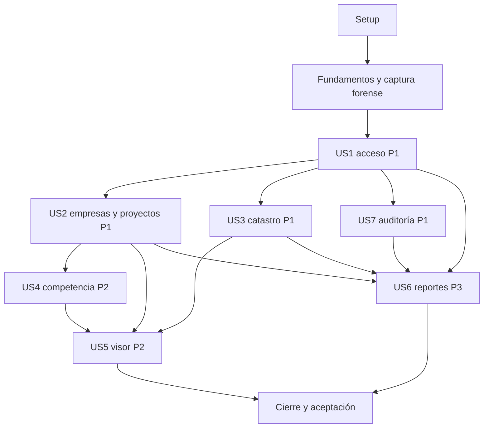

# Tasks: Gestión integral de proyectos mineros SGPM

**Input**: Diseño de `specs/001-sgpm-integral/`.
**Prerequisites**: [plan](plan.md), [spec](spec.md), [research](research.md),
[modelo](data-model.md), [HTTP](contracts/http-api.md), [correo](contracts/email-service.md),
[mapa/exportaciones](contracts/map-and-exports.md) y [quickstart](quickstart.md).
**Fecha**: 2026-10-11. Constitución4.2.0-SGPM; requisitos de origen4.1.0-SGPM.

**Tests**: Verificaciones significativas de permisos, integridad y aceptación exigidas
por SC-006/007/008 y escenarios de spec, concretadas en plan/quickstart. Preparar casos
antes de implementar la capacidad; no se impone TDD general. Las pruebas aquí listadas
son trabajo futuro, no resultados ya obtenidos.

**Organization**: Fundamentos y una fase por historia en prioridad P1→P2→P3. US7 conserva
su ID original y se ejecuta antes de US4/US5/US6. Captura forense activa desde fundamentos.

## Format: `[ID] [P?] [Story] Description`

IDs consecutivos, casillas pendientes. [P] indica archivos independientes en la misma ola
una vez completados prerrequisitos; no autoriza saltar dependencias ni exige delegación.
USn corresponde a historia de spec. Las tareas de esquema incluyen restricciones literales
extraídas del modelo; tipos y nulabilidad no quedan a discreción de implementación.

## Path Conventions

Rutas relativas al repositorio: public/, src/, views/, config/, migrations/, bin/, vendor/,
storage/, logs/, ops/, tests/. Solo public es DocumentRoot. PHP7.0.33/strict_types en todo
script distribuido, SQL9.5, JS ES2015 modular nativo, Bootstrap4.6 CSS sin SPA/transpilación.
Nunca escribir fuentes oficiales ni crear endpoints de validación/reparación topológica.

## Phase 1: Setup (Shared Infrastructure)

**Purpose**: Estructura y paquete reproducible sin despliegue.

- [X] T001 Crear estructura propuesta por plan, entrada y exclusiones de secretos/temporales en `public/index.php`, `src/bootstrap.php`, `.gitignore` y `README.md`; un paquete, DocumentRoot public.
- [X] T002 [P] Implementar carga/validación de entorno en `config/config.example.php` y `src/Infrastructure/Configuration.php`: DSN local, credenciales separadas, BASE_URL, USERKEY/APIKEY, claves cifrado/MAC y modo correo double; sin secretos reales.
- [X] T003 [P] Preparar manifiesto PHP y auditor en `ops/dependencies-php.json`, `ops/patches/README.md` y `bin/check-compatibility.php`: tFPDFv1.33/php-shapefilev3.4.1, licencias/checksums, lint PHP7.0.33 y strict_types también vendor con parches reproducibles; sin resolver dependencias en producción.
- [X] T004 [P] Preparar Bootstrap4.6.2 CSS/Leaflet1.9.4 en `public/assets/vendor/manifest.json` y `public/assets/css/app.css`; fijar origen/licencia/checksum, techo ES2015 y no incluir bootstrap.js/jQuery/Popper ni build productivo.
- [X] T005 [P] Escribir referencia Apache2.4.18 en `ops/apache/sgpm.conf`: HTTPS443, rewrite/ssl/headers,301/HSTS,nosniff y DocumentRoot public; config/storage/logs/bin/vendor privados; no activar configuración ni desplegar.
- [X] T006 [P] Documentar Ubuntu16.04/PHP7.0.33/PostgreSQL9.5.24/PostGIS2.2.x, extensiones y roles DB en `ops/acceptance-environment.md`; fuentes fixture preparadas con propietario de pruebas y mismo entorno seguro para Apache/CLI, según Q0.

**Checkpoint**: Estructura y configuración revisables sin secretos.

## Phase 2: Foundational (Blocking Prerequisites)

**Purpose**: Componentes/invariantes compartidos, obligatorios antes de historias.

- [X] T007 Implementar autoload/router SSR/API same-origin en `src/bootstrap.php`, `src/Http/Router.php` y `src/Http/routes.php`, conectado a `public/index.php`; descubrir rutas por archivos src/Http/routes/*.php para evitar cambios simultáneos al registrador.
- [X] T008 [P] Implementar PDO pgsql preparado/binding tipado y transacciones/rollback/contexto usuario-IP-request_id en `src/Infrastructure/Database.php` y `src/Infrastructure/Transaction.php`; persistencia exclusivamente PDO/SQL9.5.
- [X] T009 [P] Implementar respuestas JSON UTF-8 y errores/log diario en `src/Http/Response.php`, `src/Http/ErrorHandler.php` y `src/Infrastructure/Logger.php`; HTTP semántico, `logs/sgpm-YYYY-MM-DD.log`, mensajes amigables/request_id y ningún secreto/stack al usuario.
- [X] T010 Crear sgpm.usuario/empresa/empresa_usuarios en `migrations/001_identity_companies.sql`; concretar estado VARCHAR(20) ACTIVO/INACTIVO, es_administrador BOOLEAN NOT NULL DEFAULT FALSE, auth_version INTEGER NOT NULL DEFAULT1, version y FKs RESTRICT; «UNIQUE(empresa_id,usuario_id)» y rol «GERENTE, GEOLOGO o INVERSIONISTA, NOT NULL.». Contrato literal de campos (campo | tipo | nulo/regla; las concreciones del modelo resuelven alternativas): «| id | SERIAL PK | No | Identificador único. |»; «| correo | VARCHAR(255) | No | Único; login. |»; «| password_hash | VARCHAR(255) | No | password_hash(..., PASSWORD_BCRYPT), costo ≥ 10. |»; «| numero_documento | VARCHAR(50) | No | Documento de identidad. |»; «| nombre | VARCHAR(255) | No | Nombres y apellidos. |»; «| ultimo_acceso | TIMESTAMP | Sí | Último inicio exitoso. |»; «| estado | VARCHAR(20) / BOOL | No | ACTIVO / INACTIVO. |»; «| id | SERIAL PK | No | Identificador único. |»; «| nit | VARCHAR(50) | No | Único. |»; «| razon_social | VARCHAR(255) | No | Nombre legal. |»; «| correo | VARCHAR(255) | No | Correo corporativo principal. |»; «| telefono | VARCHAR(50) | Sí | Contacto. |»; «| direccion | VARCHAR(255) | Sí | Dirección fiscal/comercial. |»; «| ciudad | VARCHAR(100) | No | Municipio o ciudad. |»; «| departamento | VARCHAR(100) | No | Departamento. |»; «| logo_url | VARCHAR(255) | Sí | Ruta o URL del logotipo. |»; «| estado | VARCHAR(20) / BOOL | No | ACTIVO / INACTIVO. |»; empresa_usuarios: «| id | SERIAL PK | Identificador del vínculo. |»; «| empresa_id | INTEGER FK | empresa(id), NOT NULL, RESTRICT. |»; «| usuario_id | INTEGER FK | usuario(id), NOT NULL, RESTRICT. |»; «| rol | VARCHAR(20) | GERENTE, GEOLOGO o INVERSIONISTA, NOT NULL. |»; «| estado | VARCHAR(20) | ACTIVO/INACTIVO, NOT NULL, default ACTIVO. |»; «| version | INTEGER | Control concurrente, NOT NULL, default1. |».
- [X] T011 Crear proyecto e índices en `migrations/002_projects.sql`: «vecina_secuencia INTEGER NOT NULL DEFAULT0», «CHECK fecha_fin >= fecha_inicio cuando ambas existen» y «FK empresa_id RESTRICT.»; Point4326 nullable con GiST, autores de servidor y version INTEGER NOT NULL DEFAULT1. Contrato literal de campos (campo | tipo | nulo/regla; las concreciones del modelo resuelven alternativas): «| id | SERIAL PK | No | Identificador único. |»; «| empresa_id | INTEGER FK | No | empresa(id). |»; «| nombre | VARCHAR(255) | No | Nombre del proyecto. |»; «| descripcion | TEXT | Sí | Alcance técnico. |»; «| estado | VARCHAR(20) | No | ACTIVO / INACTIVO. |»; «| mineral_principal | VARCHAR(100) | No | Mineral objetivo. |»; «| fecha_inicio | DATE | Sí | Inicio de labores o constitución. |»; «| fecha_fin | DATE | Sí | Fin estimado o real. |»; «| centroide | GEOMETRY(Point, 4326) | Sí | Centroide geodésico calculado en PostGIS, permitido por constitución 4.2.0-SGPM; índice GiST obligatorio. |»; «| observaciones | TEXT | Sí | Notas técnicas. |»; «| creado_por | INTEGER FK | Sí | usuario(id), creador. |»; «| modificado_por | INTEGER FK | Sí | usuario(id), último modificador. |».
- [X] T012 Crear empresa_vecina y proyecto_empresas_vecinas en `migrations/003_neighbors.sql`: NIT conocido único/desconocido NULL, «observaciones TEXT NULL», «patron_indice INTEGER NOT NULL DEFAULT0», version, «UNIQUE(proyecto_id,empresa_vecina_id), UNIQUE(proyecto_id,orden_registro), UNIQUE(proyecto_id,color_hex), CHECK orden_registro>0 y color_hex con formato #RRGGBB.» y FKs RESTRICT. Contrato literal de campos (campo | tipo | nulo/regla; las concreciones del modelo resuelven alternativas): «| id | SERIAL PK | No | Identificador compartido de vecina. |»; «| nombre | VARCHAR(255) | No | Nombre comercial. |»; «| nit | VARCHAR(50) | Sí | NIT conocido. |»; «| observaciones | TEXT | Sí | Notas comerciales/jurídicas de la identidad. |»; proyecto_empresas_vecinas: «| id | SERIAL PK | No | Identificador del vínculo. |»; «| proyecto_id | INTEGER FK | No | Proyecto(id). |»; «| empresa_vecina_id | INTEGER FK | No | Identidad compartida de Empresa Vecina. |»; «| color_hex | VARCHAR(10) | No | Violeta automático único por proyecto. |»; «| orden_registro | INTEGER | No | Orden estable de registro dentro del proyecto. |».
- [X] T013 Crear proyecto_expedientes/guardia RN-06 en `migrations/004_project_files.sql`: «uq_proyecto_expediente UNIQUE(proyecto_id,codigo_expediente)», «CHECK tipo_expediente IN(TITULO,SOLICITUD).», PROPIO con vecinaNULL/VECINO con vecinaNOT NULL, FK compuesta al vínculo del proyecto y version; BEFORE INSERT EXISTS por fuente fija sin locks/escritura/topología catastral, código/tipo inmutables. Contrato literal de campos (campo | tipo | nulo/regla; las concreciones del modelo resuelven alternativas): «| id | SERIAL PK | No | Identificador de vínculo. |»; «| proyecto_id | INTEGER FK | No | Proyecto. |»; «| codigo_expediente | VARCHAR(100) | No | Código oficial. |»; «| tipo_expediente | VARCHAR(20) | No | TITULO o SOLICITUD. |»; «| filiacion | VARCHAR(20) | No | PROPIO o VECINO. |»; «| empresa_vecina_id | INTEGER FK | Sí | Empresa Vecina(id) compartida; obligatorio si VECINO y con vínculo al mismo proyecto. |»; «| fecha_asociacion | TIMESTAMP | No | Fecha de registro. |».
- [X] T014 Crear auditoría JSONB/append/triggers maestros en `migrations/005_audit.sql` y `ops/database/roles.sql`: sgpm_owner NOLOGIN/runtime no dueño; sin INSERT directo/UPDATE/DELETE/TRUNCATE/TRIGGER/DDL de bitácora, SECURITY DEFINER/search_path fijo/EXECUTE restringido, ámbitos históricos sin FK mutable y usuario_id RESTRICT; snapshots saneados, fallo de auditoría revierte mutación. Contrato literal de campos (campo | tipo | nulo/regla; las concreciones del modelo resuelven alternativas): «| id | SERIAL PK | No | Identificador de evento. |»; «| usuario_id | INTEGER FK | Sí | usuario(id), ejecutor. |»; «| accion | VARCHAR(50) | No | INSERT, UPDATE, DELETE, LOGIN, LOGOUT. |»; «| entidad | VARCHAR(100) | No | Entidad afectada. |»; «| valores_anteriores | JSON / JSONB | Sí | Snapshot anterior, sin secretos. |»; «| valores_nuevos | JSON / JSONB | Sí | Snapshot posterior, sin secretos. |»; «| ip | VARCHAR(45) | No | IPv4/IPv6 de origen. |»; «| fecha | TIMESTAMP | No | Marca temporal exacta, DEFAULT NOW(). |»; contexto histórico: «| entidad_id | INTEGER NULL | ID histórico del registro afectado; no FK al objeto eliminado. |»; «| empresa_id_contexto | INTEGER NULL | Ámbito histórico; NULL para eventos globales, sin FK mutable. |»; «| proyecto_id_contexto | INTEGER NULL | Proyecto histórico si aplica, sin FK mutable. |»; «| request_id | VARCHAR(64) NOT NULL | Correlación interna sin secretos. |».
- [X] T015 Implementar kernel sesión/CSRF en `src/Auth/Session.php` y `src/Auth/Csrf.php`: Secure/HttpOnly/SameSite=Lax compatible7.0, random_bytes/hash_equals, token anónimo,30min inactivo/8h absoluto y liberar lock antes de consultas largas; sin GET mutante ni CORS global.
- [X] T016 Implementar RBAC/ámbito y versión optimista en `src/Auth/Authorization.php`, `src/Http/AuthorizationMiddleware.php` y `src/Infrastructure/OptimisticLock.php`; Administrador global, Gerente/Inversionista consulta-exportación-auditoría propia, Geólogo consulta/edición propia sin exportación/auditoría, membresía vigente/activo y ajenos404.
- [X] T017 Implementar layout/escape contextual/cliente HTTP común en `views/layout.php`, `views/components/alerts.php`, `public/assets/js/modules/http.js` y `public/assets/js/modules/ui.js`; CSRF, errores/cargando/vacío, grilla Bootstrap/teclado y nada de innerHTML con atributos no confiables.
- [X] T018 Construir runner/fixtures aisladas en `tests/run.php`, `tests/fixtures/acceptance.php`, `tests/fixtures/external-cadastre.sql` y `bin/seed-fixtures.php`; A/B/cuatro roles/fuentes de 30 campos, guardia SGPM_ENV=test/base explícita y propietario de fuentes fixture separado; nunca modificar catastro real. Contrato literal de campos (campo | tipo | nulo/regla; las concreciones del modelo resuelven alternativas): «| 1 | CODIGO_EXPEDIENTE | VARCHAR(100) UNIQUE NOT NULL |»; «| 2 | MODALIDAD | VARCHAR(255) |»; «| 3 | TITULO_ESTADO | VARCHAR(100) |»; «| 4 | AREA_HA | NUMERIC(14, 4) |»; «| 5 | CLASIFICACION_MINERIA | VARCHAR(100) |»; «| 6 | ETAPA | VARCHAR(100) |»; «| 7 | SOLICITANTES_O_TITULARES | TEXT |»; «| 8 | MINERALES | TEXT |»; «| 9 | FECHA_DE_SOLICITUD | DATE |»; «| 10 | FECHA_DE_EXPEDICION | DATE |»; «| 11 | FECHA_DE_ANIVERSARIO | DATE |»; «| 12 | FECHA_DE_EXPIRACION | DATE |»; «| 13 | PUBLICADO_EN_RUCOM | VARCHAR(50) |»; «| 14 | PAR | VARCHAR(100) |»; «| 15 | TITLE_TYPE_CODE | VARCHAR(50) |»; «| 16 | TENURE_STATUS_CODE | VARCHAR(50) |»; «| 17 | MINING_CLASSIFICATION_CODE | VARCHAR(50) |»; «| 18 | TENURE_STAGE_CODE | VARCHAR(50) |»; «| 19 | CENTROID_COORDINATE | VARCHAR(100) |»; «| 20 | TENURE_ID | VARCHAR(100) |»; «| 21 | OBJECTID | INTEGER |»; «| 22 | MUNICIPIOS | VARCHAR(255) |»; «| 23 | DEPARTAMENTOS | VARCHAR(255) |»; «| 24 | MINERALES_INACTIVOS | TEXT |»; «| 25 | TIPO_TERMINACION | VARCHAR(100) |»; «| 26 | TERMINATION_TYPE_CODE | VARCHAR(50) |»; «| 27 | ACTIVE_TENURE_STATUS_IND | VARCHAR(10) |»; «| 28 | ACTIVE_APPLICATION_STATUS_IND | VARCHAR(10) |»; «| 29 | FECHA_PROCESO | DATE |»; «| 30 | the_geom | GEOMETRY(MultiPolygon, 4326) NOT NULL, índice espacial GiST |».
- [X] T019 Implementar migrador PDO y Administrador inicial CLI en `bin/migrate.php` y `bin/bootstrap-admin.php`; migrador separado, contexto sistema auditado y clave por entrada protegida, sin bypass HTTP; migraciones no reemplazan ni adquieren propiedad de fuentes externas.
- [ ] T020 Verificar fundamentos en `tests/integration/FoundationIntegrityTest.php`: rollback si auditoría falla, runtime sin mutación/DDL de bitácora ni escritura catastral; migraciones con propietario de pruebas, sin conceder UPDATE sobre fuentes para locks.

**Checkpoint**: Guardias y auditoría activas; todas las historias dependen de esta fase.

## Phase 3: User Story 1 - Acceso y administración de usuarios (Priority: P1) — MVP

**Goal**: Sesión segura, CRUD usuario/membresías, recuperación y bienvenida.
**Independent Test**: Q1/Q2/Q8 con usuarios/empresas fixture y doble de correo; sin visor.

### Tests for User Story 1

- [ ] T021 [US1] Preparar contratos sesión/usuario/membresías y recuperación en `tests/contract/AuthContractTest.php` y `tests/integration/RecoveryTest.php`;401/403/404/429, último Administrador, token30min/consumo único y revocación en siguiente petición.

### Implementation for User Story 1

- [ ] T022 [US1] Crear recuperación/limites_acceso/outbox e índices en `migrations/006_auth_notifications.sql`; token hashSHA256 único,30min, enums/estados/deduplicación del modelo y contadores sin correo plano adicional; no auditar payloads operacionales ni SMTP. Contrato literal de campos (campo | tipo | nulo/regla; las concreciones del modelo resuelven alternativas): «| id | SERIAL PK | Identificador. |»; «| usuario_id | INTEGER FK NOT NULL | usuario, RESTRICT. |»; «| token_hash | CHAR(64) NOT NULL UNIQUE | SHA-256 de token aleatorio32bytes; nunca token plano. |»; «| creado_en | TIMESTAMP NOT NULL | UTC. |»; «| expira_en | TIMESTAMP NOT NULL | Creación+30min. |»; «| consumido_en | TIMESTAMP NULL | NULL hasta consumo exitoso. |»; notificaciones_outbox: «| id | SERIAL PK | Identificador. |»; «| tipo | VARCHAR(30) NOT NULL | RECUPERACION, BIENVENIDA, REPORTE, ALERTA_AUDITORIA. |»; «| usuario_destino_id | INTEGER FK NOT NULL | Usuario registrado, RESTRICT. |»; «| empresa_id_contexto | INTEGER NULL | Ámbito autorizado al enviar; NULL solo global. |»; «| payload_cifrado | TEXT NOT NULL | Cuerpo/asunto privado cifrado; nunca en logs. |»; «| estado | VARCHAR(20) NOT NULL | PENDIENTE, PROCESANDO, ACEPTADO, FALLIDO, INDETERMINADO. |»; «| deduplicacion | VARCHAR(255) NOT NULL UNIQUE | Evento/tipo/destinatario/intervalo. |»; «| creado_en, disponible_en | TIMESTAMP NOT NULL | UTC. |»; «| expira_en | TIMESTAMP NULL | Recuperación vence con token; otras24h por defecto. |»; «| procesado_en | TIMESTAMP NULL | Finalización local. |»; «| http_status | INTEGER NULL | Metadato, no prueba de entrega. |»; «| error_codigo | VARCHAR(50) NULL | Código interno saneado. |». Crear `limites_acceso` con los tipos y restricciones definidos en `data-model.md`; mantener contadores independientes por operación/IP y operación/correo, sin correo plano, y garantizar incrementos atómicos.
- [ ] T023 [US1] Implementar DTO/repository usuario en `src/Modules/Usuarios/UserRepository.php`; correo trim/lowercase único, documento/nombre/estado, version, paginación y exclusión de hash/tokens en respuestas.
- [ ] T024 [US1] Implementar bcrypt/login/logout/auth_version en `src/Auth/AuthenticationService.php` y `src/Auth/PasswordPolicy.php`; costo10, mínimo12 caracteres/máximo72 bytes, ultimo_acceso tras éxito, rotación/invalidez sesión y eventos LOGIN/LOGOUT por append cerrado.
- [ ] T025 [US1] Implementar CRUD/protección concurrente último Administrador en `src/Modules/Usuarios/UserService.php`; actividad/rol global solo Administrador, usuarios con historial se desactivan por RESTRICT, auth_version cambia con clave/actividad/rol global, auditoría transaccional.
- [ ] T026 [US1] Implementar membresías N:M en `src/Modules/Usuarios/MembershipRepository.php` y `src/Modules/Usuarios/MembershipService.php`; solo Administrador asigna/revoca, par único, rol por empresa/version/contexto histórico y ningún permiso heredado de empresa ajena.
- [ ] T027 [US1] Implementar recuperación/límites en `src/Auth/RecoveryService.php` y `src/Auth/RateLimiter.php`: random_bytes32/SHA256/30min, consumo bajo lock+cambio clave, invalidar tokens/sesiones; login10/IP-correo/15min y recuperación3/15min,202 uniforme/429 límite.
- [ ] T028 [US1] Implementar cifrado/outbox en `src/Infrastructure/PayloadCipher.php` y `src/Jobs/NotificationRepository.php`: AES-256-CBC+HMAC-SHA256 encrypt-then-MAC,IV aleatorio/claves independientes, PENDIENTE/deduplicación y limpieza de payload al terminar/expirar; sin GCM moderno.
- [ ] T029 [US1] Implementar referencia corporativa en `src/Infrastructure/LibCurlModel.php`, `src/Infrastructure/CorporateEmailAdapter.php` y `config/email-response.example.php`; POST fijo/cinco parámetros/TLS peer-hostname/timeouts10-30/retorno string+HTTP status, perfil positivo/negativo/desconocido sin inventar JSON ni declarar ENTREGADO.
- [ ] T030 [US1] Implementar worker local en `src/Jobs/NotificationWorker.php` y `bin/worker.php`: SKIP LOCKED, confirmar PROCESANDO antes de red, revalidar destinatario/expiración, fallo ambiguo/crash→INDETERMINADO sin reenvío automático; no bloquear sesión del usuario.
- [ ] T031 [US1] Integrar bienvenida/recuperación tras commit en `src/Modules/Usuarios/UserNotifications.php` y `src/Auth/RecoveryNotifications.php`; bienvenida sin password, token temporal cifrado y correo actual de usuario registrado, ningún secreto en logs/snapshots.
- [ ] T032 [US1] Exponer GET/POST/DELETE sesion y POST recuperaciones/confirmar en `src/Http/AuthController.php` y `src/Http/routes/auth.php`; envelope/CSRF anónimo/202uniforme/401 y errores amigables según contrato.
- [ ] T033 [US1] Exponer CRUD usuario y membresías empresariales en `src/Modules/Usuarios/UserController.php`, `src/Modules/Usuarios/MembershipController.php` y `src/Http/routes/users.php`; validar rol A, version, campos y no devolver hash/auth_version/tokens.
- [ ] T034 [P] [US1] Implementar UI usuarios/membresías en `views/usuarios/index.php`, `views/usuarios/form.php` y `public/assets/js/modules/users.js`; solo Administrador, campos canónicos/estado/rol por empresa y409 amigable, después de T033.
- [ ] T035 [P] [US1] Implementar login/recuperación en `views/auth/login.php`, `views/auth/recovery.php` y `public/assets/js/modules/auth.js`; token anónimo/errores uniformes/foco/labels, no renderizar secretos después del envío, después de T032.
- [ ] T036 [US1] Ejecutar Q1/Q2/Q8 de acceso/roles/doble; completar `tests/contract/EmailContractTest.php`, `tests/fixtures/email-double.php` y `tests/integration/AuthRbacTest.php` con500/timeout/cuerpo desconocido/sin reenvío; guardar `ops/evidence/us1.md` sin afirmar conformidad de correo real.

**Checkpoint**: US1 utilizable con empresas fixture, sin requerir proyectos ni mapa.

## Phase 4: User Story 2 - Empresas y proyectos propios (Priority: P1)

**Goal**: CRUD empresarial/proyectos, logos y expedientes propios exclusivos.
**Independent Test**: Q2/Q3/Q4 con fuentes/vínculos fixture; sin UI catastral o vecinas.

### Tests for User Story 2

- [ ] T037 [US2] Preparar contratos empresas/proyectos y asociaciones en `tests/contract/ProjectsContractTest.php` y `tests/integration/ProjectFilesTest.php`; NIT/código duplicado, fuente ausente/tipo incorrecto, ámbito, versión obsoleta y borrado RESTRICT.

### Implementation for User Story 2

- [ ] T038 [US2] Implementar repository empresarial en `src/Modules/Empresas/CompanyRepository.php`; campos canónicos, version/NIT único, A global y demás solo membresías activas, sin datos ajenos.
- [ ] T039 [US2] Implementar CRUD/estado y logos en `src/Modules/Empresas/CompanyService.php` y `src/Modules/Empresas/LogoStorage.php`; solo Administrador escribe, PNG/JPEG<=5MiB, tipo/nombre seguro/privado/no ejecución y409 con dependencias.
- [ ] T040 [US2] Implementar repository proyectos en `src/Modules/Proyectos/ProjectRepository.php`; empresa única/no transferible por PUT, nombre/estado/mineral requeridos, filtros propios, autores de servidor y version.
- [ ] T041 [US2] Implementar servicio/control optimista en `src/Modules/Proyectos/ProjectService.php`; «CHECK fecha_fin >= fecha_inicio cuando ambas existen», autores/estado, Geólogo solo empresa propia, reactivaciónA y no aceptar centroide del cliente.
- [ ] T042 [US2] Implementar vinculación/desvinculación/filiación en `src/Modules/Proyectos/ExpedienteRepository.php` y `src/Modules/Proyectos/ExpedienteService.php`; fuente fija/INSERT condicionado/PDO, vecina del mismo proyecto,23505 uq_proyecto_expediente→409 tras rollback, código/tipo inmutables y sin locks UPDATE catastrales.
- [ ] T043 [US2] Implementar centroide en `src/Modules/Proyectos/CentroidService.php`: unir geometrías PROPIO disponibles, proyectar3116/calcular/volver4326, Point/GiST,NULL si no hay fuentes; no topología redundante ni medición visual como área oficial.
- [ ] T044 [US2] Exponer CRUD empresa y logo en `src/Modules/Empresas/CompanyController.php` y `src/Http/routes/companies.php`; filtros/autorización/version/HTTP del contrato y nunca path de almacenamiento recibido.
- [ ] T045 [US2] Exponer CRUD proyectos y GET/POST/PUT/DELETE expedientes en `src/Modules/Proyectos/ProjectController.php`, `src/Modules/Proyectos/ExpedienteController.php` y `src/Http/routes/projects.php`; CSRF/version/201/204/400/404/409.
- [ ] T046 [P] [US2] Implementar UI empresas/logo en `views/empresas/index.php`, `views/empresas/form.php` y `public/assets/js/modules/companies.js`; campos canónicos/NIT duplicado/lectura no administradores, después de T044.
- [ ] T047 [P] [US2] Implementar UI proyectos/asociación propia por código y tipo en `views/proyectos/index.php`, `views/proyectos/form.php`, `views/proyectos/expedientes.php` y `public/assets/js/modules/projects.js`; permisos y fuente ausente/duplicados claros, sin depender de buscadorUS3, después de T045.
- [ ] T048 [US2] Ejecutar Q2/Q3/Q4 y completar `tests/integration/ProjectConcurrencyTest.php`; carreras propio/vecino fixture dejan una201/otra409/única fila, código permitido en otro proyecto y fallo auditoría revierte; guardar `ops/evidence/us2.md`.

**Checkpoint**: CRUD y asociación propia funcionan; vínculos fixture permiten RN-12 sin US4 UI.

## Phase 5: User Story 3 - Consulta del catastro externo (Priority: P1)

**Goal**: Búsqueda de solo lectura y ficha de30 atributos.
**Independent Test**: Q3 con fuentes fixture yUS1, sin necesitar CRUD de proyectosUS2.

### Tests for User Story 3

- [ ] T049 [US3] Preparar contrato de cinco filtros/ficha30 campos en `tests/contract/CadastreContractTest.php`; tipo TITULO/SOLICITUD, fechasDATE/UTF-8/NULL/GeoJSON, código en ambas fuentes y resultado vacío.

### Implementation for User Story 3

- [ ] T050 [US3] Implementar inspección/adaptador canónico en `src/Modules/Catastro/CadastreSchema.php` y `bin/check-cadastre.php`; verificar30 columnas/tipos/código único/the_geom NOT NULL/GiST y nombres físicos quoted/normalizados; rechazar incompatibilidad sin ALTER ni índices externos por runtime.
- [ ] T051 [US3] Implementar repository de consulta en `src/Modules/Catastro/CadastreRepository.php`; cinco filtros whitelist/binding, UNION ALL discriminando fuente, paginación25/máximo100 y ficha completa; nada de SQL/tabla/orden del usuario ni escritura catastral.
- [ ] T052 [US3] Exponer GET catastro y catastro/{tipo}/{codigo} en `src/Modules/Catastro/CadastreController.php` y `src/Http/routes/cadastre.php`; sesión activa, atributos oficiales sin filiaciones privadas ajenas.
- [ ] T053 [US3] Implementar buscador/ficha en `views/catastro/index.php`, `views/catastro/detail.php` y `public/assets/js/modules/cadastre.js`; cinco filtros/paginación/30 atributos/NULL explícito/escape.
- [ ] T054 [US3] Verificar SELECT exclusivo/retiro externo en `tests/integration/CadastreReadOnlyTest.php`; propietario fixture modifica solo DB de pruebas, runtime INSERT/UPDATE/DELETE denegados, vínculo histórico permanece y nueva asociación retirada400.
- [ ] T055 [US3] Ejecutar Q3 y verificar superficie sin endpoints topológicos/escritura oficial en `tests/contract/CadastreSurfaceTest.php`; guardar `ops/evidence/us3.md` con cotejo de30 atributos/filtros.

**Checkpoint**: Consulta oficial usable sin visor y sin modificar sincronización.

## Phase 6: User Story 7 - Auditoría forense (Priority: P1)

**Goal**: Consulta inmutable por ámbito y alertas autorizadas.
**Independent Test**: Q9 con cambios de usuario/membresía/empresa fixture y fundamentos;
no necesita visor/reportes. Captura activa desde T014.

### Tests for User Story 7

- [ ] T056 [US7] Preparar pruebas de consulta histórica en `tests/contract/AuditContractTest.php`: Administrador consulta auditoría global; Gerente e Inversionista vinculados a la empresa A consultan únicamente eventos de A y reciben 404 al intentar acceder a eventos de B; Geólogo recibe 403 al consultar auditoría. Verificar que el contexto empresarial se conserva tras borrar la entidad y que las consultas empresariales no revelan eventos globales ni secretos.

### Implementation for User Story 7

- [ ] T057 [US7] Implementar consulta de auditoría en `src/Modules/Auditoria/AuditRepository.php`; empresa_id_contexto histórico, filtros fecha/acción/entidad/usuario y orden fecha,id, sin depender de joins a objetos borrados ni permitir mutaciones.
- [ ] T058 [US7] Exponer GET auditoria globalA y GET empresas/{id}/auditoria paraX en `src/Modules/Auditoria/AuditController.php` y `src/Http/routes/audit.php`; no POST/PUT/DELETE de bitácora ni SQL crudo.
- [ ] T059 [US7] Implementar alertas de roles/desactivación/borrados agrupadas por minuto en `src/Modules/Auditoria/AuditAlerts.php`, `src/Jobs/AuditAlertProducer.php` y su integración en `bin/worker.php`; Administradores activos/outbox deduplicada/plantilla saneada y sin recursión por jobs/correo; usar US1 y ejecutar el productor antes de reclamar correo, sin esperar al scheduler de US6.
- [ ] T060 [US7] Implementar filtros/ficha antes-después en `views/auditoria/index.php`, `views/auditoria/detail.php` y `public/assets/js/modules/audit.js`; rol/ámbito y escape de JSON como texto.
- [ ] T061 [US7] Verificar snapshots/LOGIN-LOGOUT/usuarioRESTRICT/identidad global en `tests/integration/AuditSnapshotsTest.php`; INSERT anteriorNULL/DELETE nuevoNULL, ámbitos intactos y cero password_hash/token/APIKEY/USERKEY.
- [ ] T062 [US7] Verificar rollback/privilegios en `tests/integration/AuditRollbackTest.php`; fallo forzado solo propietarioDB de pruebas, runtime sin UPDATE/DELETE/TRUNCATE/INSERT directo y mutación maestra revertida completa.
- [ ] T063 [US7] Ejecutar Q9/alertasQ8 con doble, inspeccionar log diario saneado y guardar `ops/evidence/us7.md`; A/B/global y accesoHTTP directo, sin afirmar envío real.

**Checkpoint**: Captura/consulta/alertas locales conformes; ningún rol funcional edita bitácora.

## Phase 7: User Story 4 - Competencia y empresas vecinas (Priority: P2)

**Goal**: Identidad compartida, vínculos por proyecto y expedientes con color/patrón heredado.
**Independent Test**: Q4/Q6 con dos empresas/proyectos y9/17vecinas; estilo persistido verificable sinUS5.

### Tests for User Story 4

- [ ] T064 [US4] Preparar contratos vecinos/aislamiento en `tests/contract/NeighborsContractTest.php`; NIT duplicado/reutilización cross-empresa sin filtraciones/notas por vínculo/global solo Administrador y bajas con expedientes409.

### Implementation for User Story 4

- [ ] T065 [P] [US4] Implementar identidad compartida en `src/Modules/Vecinas/NeighborRepository.php`; NIT conocido único/desconocido NULL, no deduplicar nombre y resolver NIT exacto con DTO mínimo sin proyectos ajenos, después de T064.
- [ ] T066 [P] [US4] Implementar vínculos en `src/Modules/Vecinas/ProjectNeighborRepository.php`; ámbito/version/notas/color/ordinal/patrón y bloqueo de proyecto para asignación, eliminación no afecta otros vínculos, después de T064.
- [ ] T067 [US4] Implementar `src/Modules/Vecinas/NeighborStylePolicy.php`: ocho tonos literales del modelo, posteriores R96..191/G32..95/B192..255 sin colisiones, «patron_indice=0 para ordinal<=8» y «1+floor((ordinal-9)/8)» desde9; agotamiento409/no repetición/no reciclar ordinal.
- [ ] T068 [US4] Implementar creación/reutilización/vínculo en `src/Modules/Vecinas/ProjectNeighborService.php`; FOR UPDATE proyecto/incrementar vecina_secuencia/color único/herencia/rol E/audit/rollback completo sin identidad huérfana.
- [ ] T069 [US4] Implementar identidad global en `src/Modules/Vecinas/NeighborService.php`; existente solo Administrador/version/eliminar sin vínculos; Geólogo solo notas de su vínculo, no identidad ajena.
- [ ] T070 [US4] Exponer listado/resolver/crear/editar/desvincular de proyecto en `src/Modules/Vecinas/ProjectNeighborController.php` y `src/Http/routes/project-neighbors.php`; exactamente identidad existente o nueva, CSRF/404/409 y no color/ordinal del cliente.
- [ ] T071 [US4] Exponer GET/GETid/PUT/DELETE catálogo global en `src/Modules/Vecinas/NeighborController.php` y `src/Http/routes/neighbors.php`; solo Administrador/auditoría global, sin edición geográfica oficial.
- [ ] T072 [P] [US4] Implementar vecinos/asociadorVECINO en `views/vecinas/project.php` y `public/assets/js/modules/project-neighbors.js`; reutilizaciónNIT/notas/estilo automático/RN-12 con propio o vecino previo, después de T070.
- [ ] T073 [P] [US4] Implementar catálogo global en `views/vecinas/catalog.php` y `public/assets/js/modules/neighbors.js`; solo Administrador, distinguir identidad/vínculo e informar alcance compartido de cambio nombre/NIT, después de T071.
- [ ] T074 [US4] Probar carreras de color/ordinal/vínculo en `tests/integration/NeighborConcurrencyTest.php`; unicidad/no reciclado/herencia y ediciónA no modificaB.
- [ ] T075 [US4] Ejecutar Q4/Q6 con9/17vecinas/reutilización/exclusividad y guardar `ops/evidence/us4.md`; filiación verificada contra restricciones reales, no soloUI.

**Checkpoint**: Competencia y estilo estables por proyecto; RN-12 cubre propio y vecino.

## Phase 8: User Story 5 - Exploración cartográfica (Priority: P2)

**Goal**: Bases, etiquetas, Identify, medición y capas de trabajo sin editar catastro.
**Independent Test**: Q5/Q6 con proyecto fixture/archivos de tres formatos/fallos de proveedor.

### Tests for User Story 5

- [ ] T076 [US5] Preparar contratos mapa/Identify/importación en `tests/contract/MapContractTest.php`; GeoJSON autorizado,30 atributos/área_origen/bbox inválido400/fuente ausente/empresa ajena404.

### Implementation for User Story 5

- [ ] T077 [US5] Fijar versiones/checksums/licencias y verificar distribuciones ES2015 de draw1.0.4/Control.Measure/GoogleMutant/esri-leaflet/Turf en `public/assets/vendor/manifest.json` y `ops/map-providers.md`; sin build/transpilación productivos, claves navegador restringidas por origen, no secretos corporativos.
- [ ] T078 [US5] Implementar mapa/bbox en `src/Modules/Visor/MapRepository.php`; geometrías originales/propiedades de vínculo-color y patrón, continuaciones explícitas/fuentes_no_disponibles/filtro empresarial, sin omitir/simplificar silenciosamente.
- [ ] T079 [US5] Implementar Identify/área en `src/Modules/Visor/IdentifyService.php` y `src/Modules/Visor/AreaService.php`;30 atributos+filiación, AREA_HA o ST_Area(the_geom::geography)/10000.0, cero distintoNULL y no topología redundante.
- [ ] T080 [US5] Implementar importación/temporales en `src/Modules/Visor/ImportService.php` y `src/Infrastructure/TemporaryFiles.php`;20MiB entrada/100MiB expandidos/5000 objetos/500000 vértices, ZIP sin traversal/symlinks/ejecutables, límites antes de extraer y limpieza éxito/error.
- [ ] T081 [P] [US5] Implementar parsers en `src/Modules/Visor/GeoJsonReader.php` y `src/Modules/Visor/KmlReader.php`; estructura/formato/WGS84, XML sinDTD/entidades/red, sin datos ficticios ni validación topológica/traslapes oficiales, después de T080.
- [ ] T082 [P] [US5] Implementar `src/Modules/Visor/ShapefileReader.php`; ZIP .shp/.shx/.dbf/.prj4326 y .cpgUTF-8 si existe, CRSotro/.prjausente rechazados, Readerauditado sin DBalterno, después de T080.
- [ ] T083 [US5] Exponer mapa/Identify/importar en `src/Modules/Visor/MapController.php`, `src/Modules/Visor/ImportController.php` y `src/Http/routes/map.php`; rol C/CSRF, respuesta temporal sin persistir fuente/proyecto y400/413/415.
- [ ] T084 [US5] Implementar inicialización/selectorOSM-Google4-ESRI2 en `public/assets/js/modules/map.js` y `public/assets/js/modules/map-baselayers.js`; atribución, recuperación proveedor caído y atributos consultables sin tiles.
- [ ] T085 [P] [US5] Implementar `public/assets/js/modules/map-styles.js`: propioTITULO azul#007bff/SOLICITUD verde#28a745/vecino violeta heredado, patrónSVG desde9 y tooltipRN-09/10<200ms local sin petición en hover/HTML inseguro, después de T084.
- [ ] T086 [P] [US5] Implementar Identify accesible en `public/assets/js/modules/map-identify.js` y `views/visor/identify.php`;30 atributos/filiación/fechas/NULL/fuente no disponible y escape, después de T084.
- [ ] T087 [P] [US5] Implementar `public/assets/js/modules/map-tools.js`; medidasm/km/m²/ha/km², trazos/marcadores de trabajo y Turf, centroide visual separado del persistido, ninguna edición de polígonos oficiales, después de T084.
- [ ] T088 [P] [US5] Implementar `public/assets/js/modules/map-imports.js`; tres formatos/capas temporales, color/opacidad0..1 y errores sin borrar capas previas ni escribir catastro, después de T084.
- [ ] T089 [US5] Integrar mapa/leyenda/paneles en `views/visor/map.php` y `public/assets/css/map.css`; responsive/lotes/SVGpatrones-Canvasotrascapas y estado completo solo al dibujar última geometría.
- [ ] T090 [US5] Implementar/ejecutar guion bases-tooltip-Identify-medidas-teclado en `tests/browser/map-scenarios.md`; guardar `ops/evidence/us5-browser.md` con latencias/capturas saneadas, no afirmar proveedores reales verificados con dobles.
- [ ] T091 [US5] Verificar archivos válidos/corruptos/traversal/bomba/CRS/XMLexterno en `tests/integration/ImportSecurityTest.php` y `tests/fixtures/imports/manifest.json`; límites y ausencia de cambiosDB/temporales abandonados.
- [ ] T092 [US5] Ejecutar Q5/Q6 con fixture y claves autorizadas disponibles, contrastar área/centroide y guardar `ops/evidence/us5.md`; proveedor no probado queda pendiente, no conforme sin evidencia.

**Checkpoint**: Visor y trabajo geográfico disponibles sin editar límites oficiales.

## Phase 9: User Story 6 - Reportes y exportaciones (Priority: P3)

**Goal**: Seis formatos/jobs privados/descarga autorizada/programación corporativa.
**Independent Test**: Q7/Q8 con usuario X/conjunto conocido/doble, sin necesitar UI cartográfica.

### Tests for User Story 6

- [ ] T093 [US6] Preparar contratos exportación/programación en `tests/contract/ExportsContractTest.php`;202/estado/LISTO/410, Geólogo 403/ajeno404, solicitanteX oA y revocación impide archivo.

### Implementation for User Story 6

- [ ] T094 [US6] Crear exportacion_job/programacion_reportes/programacion_destinatarios/índices en `migrations/007_exports_schedules.sql`; enums/JSONB/filtros/archivo privado, «Archivo24h por defecto.», diario09:00 America/Bogota inicialINACTIVO, destinatariosPK/FKsRESTRICT; triggers de programación maestra con funciónT014/ámbito empresarial. Contrato literal de campos (campo | tipo | nulo/regla; las concreciones del modelo resuelven alternativas): «| id | SERIAL PK | Identificador de trabajo. |»; «| usuario_id | INTEGER FK NOT NULL | Solicitante, RESTRICT. |»; «| empresa_id | INTEGER NOT NULL | Ámbito único, revalidado. |»; «| proyecto_id | INTEGER NULL | Filtro opcional del mismo ámbito. |»; «| formato | VARCHAR(20) NOT NULL | PDF, XLSX, CSV, GEOJSON, KML, SHAPEFILE. |»; «| filtros | JSONB NOT NULL | Filtros normalizados y cerrados. |»; «| estado | VARCHAR(20) NOT NULL | PENDIENTE, PROCESANDO, LISTO, FALLIDO, EXPIRADO. |»; «| archivo_relativo | VARCHAR(255) NULL | Ruta generada por servidor, nunca del cliente. |»; «| creado_en, expira_en | TIMESTAMP NOT NULL | Archivo24h por defecto. |»; «| error_codigo | VARCHAR(50) NULL | Mensaje técnico saneado. |». Contrato literal adicional de programación: «programacion_reportes(id SERIAL PK, empresa_id INTEGER FK NOT NULL, creado_por INTEGER FK NOT NULL, formato VARCHAR(20) NOT NULL, filtros JSONB NOT NULL, hora_local TIME NOT NULL DEFAULT09:00, zona VARCHAR(50) NOT NULL DEFAULT America/Bogota, estado VARCHAR(20) NOT NULL DEFAULT INACTIVO, version INTEGER NOT NULL DEFAULT1). programacion_destinatarios(programacion_id INTEGER FK, usuario_id INTEGER FK), PK compuesta, ambos NOT NULL/RESTRICT.».
- [ ] T095 [US6] Implementar jobs/conjunto exportable en `src/Modules/Reportes/ExportRepository.php`; filtros por whitelist empresa/proyecto/códigos/atributos/filiación, fuentes ausentes declaradas, solo PDO/estados del modelo y sin path físico expuesto.
- [ ] T096 [P] [US6] Implementar `src/Modules/Reportes/CsvExporter.php` y `src/Modules/Reportes/XlsxExporter.php`; UTF-8/fórmulasCSV neutralizadas, OOXMLreal/ZipArchive/XMLWriter/texto explícito/número-fecha controlados, no HTML renombrado, después de T095.
- [ ] T097 [P] [US6] Implementar `src/Modules/Reportes/PdfExporter.php`; tFPDFv1.33/fuente UTF-8 licenciada auditada, tabular paginado empresa/proyecto/filtros/fecha/leyenda/acentos, sin tiles no licenciados, después de T095.
- [ ] T098 [P] [US6] Implementar `src/Modules/Reportes/GeoJsonExporter.php` y `src/Modules/Reportes/KmlExporter.php`;4326original/atributos, Polygon-MultiGeometry/ExtendedData, KMLsinZ clampToGround+aviso/no altitud ficticia, después de T095.
- [ ] T099 [P] [US6] Implementar `src/Modules/Reportes/ShapefileExporter.php`; Writer desde PDO/ZIPshp-shx-dbf-prj-cpg/manifiesto/mapeo, DBF<=10 caracteres/aliasesEXP_CODE-TITULARES-Fnn, texto largo en sidecar attributes.json sin truncamiento silencioso, después de T095.
- [ ] T100 [US6] Implementar jobs/publicaciónatómica en `src/Jobs/ExportWorker.php` y registrar en `bin/worker.php`; reautorizar antes de consultar/publicar, no parciales, ruta privada aleatoria/errores saneados y ninguna conexiónDBalternativa.
- [ ] T101 [US6] Implementar programación/destinatarios/deduplicación fecha-programa-usuario en `src/Modules/Reportes/ScheduleService.php`, `src/Jobs/ReportScheduler.php` y `bin/scheduler.php`; habilitar solo destinatarios activos X, diario09:00Bogota/revalidar cada ejecución, integrar productoralertasT059 y no correos arbitrarios.
- [ ] T102 [US6] Exponer solicitar/estado/descarga en `src/Modules/Reportes/ExportController.php` y `src/Http/routes/exports.php`; CSRF/revalidación, Content-Disposition seguro/MIME,409noLISTO/410expirado, sin URL pública/path interno.
- [ ] T103 [US6] Exponer GET/POST/PUT/DELETEprogramación solo Administrador en `src/Modules/Reportes/ScheduleController.php`, `src/Http/routes/schedules.php` y `views/reportes/schedules.php`; version/hora/destinatarios/auditoría, desactivar si dependenciasRESTRICT.
- [ ] T104 [US6] Implementar reportes/programación en `views/reportes/index.php` y `public/assets/js/modules/reports.js`; conjuntofiltrado, controles por rol, pollingestado/descarga/caducidad/errores, sin exposición aGeólogo.
- [ ] T105 [US6] Implementar mantenimiento/cron en `src/Jobs/MaintenanceWorker.php` y `ops/cron/sgpm`; archivos24h, payloads borrados al terminar/expirar, metadatos outbox30d, jobs huérfanos controlados y entorno seguro sin cron HTTP.
- [ ] T106 [US6] Integrar correo reportes en `src/Modules/Reportes/ReportNotifications.php`; enlaceautenticado/cinco parámetros/sin adjuntos no contratados/destinatario autorizado/deduplicación, nunca prometer entrega porHTTP 200.
- [ ] T107 [US6] Verificar seisformatos/DBFsidecars en `tests/integration/ExportFormatsTest.php` y `tests/fixtures/exports/manifest.json`; filas/códigos/geometría/UTF-8/fórmulas, fuentes ausentes documentadas sin polígonos fabricados.
- [ ] T108 [US6] Verificar revocación/generación/descarga/envío/caducidad/scheduler doble en `tests/integration/ExportAuthorizationTest.php` y `tests/integration/ScheduleDeduplicationTest.php`; sin filtraciones/archivo parcial, un envío local por destinatario-intervalo.
- [ ] T109 [US6] Ejecutar Q7/Q8 con worker/doble y guardar `ops/evidence/us6.md` por formato/ámbito; conformidad de correo real se exige enT118 y no se infiere del doble.

**Checkpoint**: Exportación/programación cumplen contrato local; descarga denegada tras revocar acceso.

## Phase 10: Polish & Cross-Cutting Concerns

**Purpose**: Validación integral/paquete revisable, sin despliegue automático.

- [ ] T110 Ejecutar compatibilidad todoPHP7.0.33/strict_types/SQL9.5.24-PostGIS2.2/JS≤ES2015 con `bin/check-compatibility.php` y guardar `ops/evidence/compatibility.md`; rechazar features posteriores y vendor no auditado.
- [ ] T111 Completar censo de rutas/RBAC en `tests/contract/RouteAuthorizationMatrixTest.php` y `ops/evidence/authorization.md`; cada endpoint/objeto/lista/mapa/Identify/job/descarga/auditoría con cuatro roles,A/B/inactivo/revocado, no soloUI.
- [ ] T112 Ejecutar CSRF/XSS/SQLi/archivos privados/transporte en `tests/contract/WebSecurityTest.php` y `ops/evidence/security.md`; HTTPS/301/HSTS/certificado/headers y no config-storage-logs-bin-vendorporHTTP, errores sin trazas/secretos.
- [ ] T113 Ejecutar teclado/errores/vacíos/UTF-8 a360/768/1440 en `tests/browser/responsive-scenarios.md` y `ops/evidence/responsive.md`; corregir solo fallos observados de vistas/módulos correspondientes.
- [ ] T114 Crear fixture de carga en `tests/fixtures/performance/manifest.json` y ampliar `bin/seed-fixtures.php`;100000 filas,500 polígonos/50000 vértices y5000/500000, huecos/multiparte/distribución/checksums, guardiatest y ninguna simplificación para aprobar.
- [ ] T115 Implementar runner50 sesiones/instrumentacióncliente en `tests/performance/run.php` y `tests/browser/performance-scenarios.md`;120swarmup/600smedición/mezcla60-20-10-5-5/pausas1–3s/tresfrías-trescalientes/máximo-p95, no ocultar incumplimientos conp95.
- [ ] T116 Ejecutar Q11 en entorno4vCPU/8GiB/SSD y cliente/red documentados, guardar `ops/evidence/performance.md`; consultas<3s/500 polígonos<5s/5000<8s/tooltip<200ms/50 usuarios; optimizar solo fallos sin omitir geometrías ni alterar umbrales, repetir casos afectados y no marcar cumplido sin medición conforme.
- [ ] T117 Cerrar paquete reproducible en `ops/dependencies-php.json`, `public/assets/vendor/manifest.json` y `ops/evidence/dependencies.md`; cada tag-commit-checksum-licencia-parche, smokePHP7.0 dePDF/Shapefile y Leaflet/plugins, sin resolver/compilar en producción.
- [ ] T118 Incorporar perfil de respuesta real verificado en `config/email-response.example.php` y evidencia anonimizada en `ops/evidence/email-conformance.md`; obtener documentación/muestras autorizadas, no inventarJSON; validar despacho solo con instrucción explícita de envío/destinatario autorizado. Si falta contrato o autorización, mantener double/puerta productiva pendiente y no cerrar esta tarea como cumplida.
- [ ] T119 Ejecutar Q0–Q11/suites con `tests/run.php`, consolidar `ops/evidence/acceptance.md` y sincronizar `specs/001-sgpm-integral/quickstart.md` a interfaces implementadas; distinguir resultados reales/no ejecutados/dependencias sin inventarlos ni cambiar requisitos.
- [ ] T120 Preparar paquete/guía revisables en `ops/release-checklist.md`, `ops/deployment.md` y `README.md`; roles/configuración sin secretos/cron/HTTPS/migraciones internas/catastro/restauración y permisos, sin desplegar/publicar ni migrar producción por generar tareas.

**Checkpoint**: Cierre solo con evidencia real. T118 no se completa mediante doble de correo.

## Dependencies & Execution Order

### Phase Dependencies

Fase1→fase2 bloquea todas las historias. US1 habilita acceso real. Después US2/US3/US7
pueden progresar con fixtures independientes. US7 es P1: entregar consulta y alertas antes
de P2/P3; captura forense está activa desde T014, no espera a US7.

| Fase | Tareas | Prerrequisito de entrega | Prueba independiente |
| --- | --- | --- | --- |
| Setup | T001–T006 | Ninguno | Paquete/configuración sin secretos. |
| Fundamentos | T007–T020 | Setup | Migraciones/guardias/auditoría transaccional. |
| US1 P1 | T021–T036 | Fundamentos | Login/roles/recuperación con empresas fixture. |
| US2 P1 | T037–T048 | US1 y fundamentos | Empresa/proyecto/asociación existente/duplicado rechazado. |
| US3 P1 | T049–T055 | US1 y fundamentos | Cinco filtros/30 atributos/SELECT exclusivo. |
| US7 P1 | T056–T063 | US1 y fundamentos | Cambio trazado/ámbito histórico/bitácora inmutable. |
| US4 P2 | T064–T075 | US1 yUS2 | IdentidadA-B/9y17 estilos/RN-12. |
| US5 P2 | T076–T092 | US1/US2/US3/US4 | Mapa/Identify/medición/importación. |
| US6 P3 | T093–T109 | US1/US2/US3 yUS7 para alertas | Seis formatos/revocación/caducidad/programación. |
| Cierre | T110–T120 | Todas las historias | Q0–Q11 y puertas externas verificadas. |

### User Story Dependencies

El gráfico muestra entrega completa; un adaptador puede desarrollarse con fixtures sin
esperar otra UI. No presentar un incremento parcial como SGPM completo. MVP de acceso:
fases1/2+US1. MVP minero de administración/consulta/trazabilidad: añadirUS2+US3+US7.

### Within Each User Story

Orden por defecto: casos de prueba→repositorios→servicios→controladores/rutas→UI→validación.
Una tarea no se completa solo al crear archivos: cumplir su descripción/aceptación.
Las columnas/type/nulo citadas en tareas de esquema son contrato, no opciones libres.
Escrituras son transaccionales y auditadas desde el inicio.

Dependencias adicionales: T028/T029→T030; T024/T027/T030→T031/T032; T023/T025/T026→T033;
T040–T043→T045; T065–T067→T068; T078–T082→T083; T084–T088→T089;
T094–T099→T100/T102; T101/T103/T106→T109. T059 usaUS1 y T101 lo conecta al scheduler.
No paralelizar bin/worker.php, bin/seed-fixtures.php o manifiestos cuando compartan edición.

### Parallel Opportunities

Después de T001: T002–T006, archivos separados. Después de T007: T008/T009.
tras US1: US2/US3/US7 tienen módulos/rutas separados; cada prueba usa base aislada propia.
[P] por historia se ejecuta solo en las olas descritas a continuación. T077/T117 se realizan
posteriormente aT004 yT003; no actualizar simultáneamente los mismos manifiestos.

## Parallel Example: User Story 1

TrasT021–T033: T034 UI usuarios/membresías y T035 login/recuperación, archivos separados;
T036 integra/verifica. No comparten una plantilla editable en paralelo.

## Parallel Example: User Story 2

TrasT044/T045: T046 UI empresas y T047 UI proyectos. T048 comprueba concurrencia sobre
servicios integrados, sin necesitar UI vecinasUS4.

## Parallel Example: User Story 3

T049 diseño de casos y T050 inspección pueden prepararse por separado; T051 espera aliases
verificados. No se marcan[P] porque la secuencia normal espera catálogo y contrato antes
de implementar consultas. La independencia de archivos no elimina una dependencia de datos.

## Parallel Example: User Story 7

TrasT057/T058: T060 UI y T061 pruebas de snapshots pueden progresar separadamente.
T062 usa base aislada propia para fallo forzado; T063 espera alertasT059 y pruebas.

## Parallel Example: User Story 4

TrasT064: T065 identidad/T066 vínculo. TrasT070/T071: T072 UI proyecto/T073 catálogo.
T074/T075 esperan integración para comprobar aislamiento entreA/B.

## Parallel Example: User Story 5

TrasT080: T081 JSON-KML/T082 Shapefile. TrasT083/T084: T085 estilos/T086Identify/
T087herramientas/T088importación, archivos separados. T089 integra los módulos.

## Parallel Example: User Story 6

TrasT094/T095: T096CSV-XLSX/T097PDF/T098GeoJSON-KML/T099Shapefile. T100 los integra;
pruebas/temporales aislados por job, sin escritura compartida del mismo archivo.

## Implementation Strategy

### MVP First (User Story 1 Only)

CompletarT001–T036 y validarUS1 con empresas fixture/doble corporativo. La auditoría ya
captura cambios. Este MVP valida acceso, no reemplaza sistema minero; no habilitar correo
real antes de conformidadT118. No desplegar por alcanzar este checkpoint documental.

### Incremental Delivery

US2/US3/US7 entregan administración/consulta/trazabilidad. AñadirUS4 competencia, US5 visor
y US6 exportaciones/programación. Conservar pruebas de incrementos y repetir las afectadas
cuando cambien componentes. Aceptación final solo con evidencia y puertas externas cumplidas.

### Parallel Team Strategy

Las olas permiten trabajo en archivos separados si se decide usar equipo. No requieren
agentes ni autorización adicional para tareas locales ya encargadas; tampoco autorizan
publicación/despliegue/mensajes externos. Las dependencias prevalecen sobre paralelismo.

## Trazabilidad y condiciones de cierre

| Requisitos | Tareas | Evidencia futura |
| --- | --- | --- |
| RF-01.1–01.6 / RNF-10/13 | T010,T015–T016,T021–T036 | us1.md, authorization.md |
| RF-02.1–02.5 | T010,T038–T039,T044,T046,T048 | us2.md |
| RF-03.1–03.6 / RN-01/06/12 | T011,T013,T040–T043,T045,T047–T048 | us2.md |
| RF-04.1–04.5 | T018,T049–T055 | us3.md |
| RF-05.1–05.8 / RN-04/07/08 | T012,T064–T075 | us4.md |
| RF-06.1–06.22 / RN-09/10/11/13 | T076–T092 | us5.md, us5-browser.md |
| RF-07.1–07.4 | T093–T109 | us6.md |
| RF-08.1–08.3 | T014,T020,T056–T063,T094 | us7.md |
| RNF-01–04/11/12/14–20 | T002–T006,T008–T009,T029,T050,T077,T110–T113,T117–T120 | compatibility.md, security.md, dependencies.md |
| RNF-05–09 | T114–T116 | performance.md |

RangosRF mantienen numeración oficial; no inventar subrequisitos no aportados. Evidencias
ops/evidence son resultados futuros. T118 no se cierra con un doble. Si para conformidad
real se necesita contactar a terceros/enviar correo, obtener instrucción explícita para
ese envío; no pedir autorización para el trabajo local independiente ni detenerlo.

## Notes

Orden de autoridad: constitución→spec→plan/modelo/contratos→tasks. Seguir restricciones
literales y concreciones posteriores del modelo. Ningún bloqueo real permite marcar una
tarea como cumplida sin resultado. Generar estas tareas no implementa código ni ejecuta
pruebas, despliegues o migraciones productivas.

## Implementation status — 2026-10-12

T001–T019: archivos implementados; evidencia local en `ops/evidence/foundation.md`.
T020 pendiente: la prueba de integración se detuvo por ausencia de PHP 7.0.33 en el runtime activo.
No se ha certificado ejecución en PostgreSQL 9.5.24/PostGIS 2.2.x ni desplegado.
T021–T120 no iniciadas: dependen de la puerta de fundamentos.
Las dos excepciones del checklist fueron aprobadas; sus casillas se conservaron.
